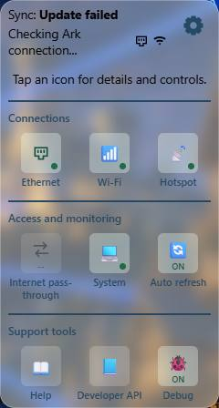
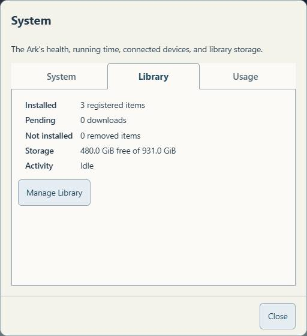

# User Guide

Screenshots use example values. Your installed collections, capacity, dates and connection status may differ. Select any screenshot to see it at full size.

## Connect and open the library

- Power the Ark and leave its content SSD connected.
- Join the DataArk Wi-Fi hotspot using the network details supplied with the appliance.
- Tap Sign in to network if your phone offers it. Otherwise open http://192.168.4.1/ in a browser.
- If your device warns that this Wi-Fi has no internet, choose to remain connected when using the offline library.

On the home network, http://dataark/ may also work. Name resolution varies by device; use the appliance's address if necessary. The hotspot address is the dependable manual entry while connected directly to DataArk.

## Read a collection

Choose a local collection or archive link on the landing page. ZIM archives open in the Ark's Kiwix reader. Search within that reader to find articles. Local links can work without upstream internet; links marked online need it.

Only installed material is available offline. A downloading or queued collection is not ready yet. Installed OpenStreetMap packages open in the local map viewer; an external publisher link still requires internet. Other geographic resources may be PDFs or downloadable GIS datasets and need their own viewers.

## Copy content for another device

Use Access your content for the supported methods. Browser downloads and the read-only Offline-Archives SMB share provide original files. Anonymous read-only FTP exposes the public library under the library folder. Modern browsers generally need a separate FTP client for FTP transfers.

Copying a ZIM file does not make it readable by itself. Install a compatible Kiwix reader on the destination device. The Windows portable reader needs its entire kiwix-viewer folder, including dependencies, not just the executable. A Windows executable is not an Android or macOS reader. PDFs and GIS archives need suitable applications on the receiving device.

## Understand the compact status box

Sync shows the updater's current activity, including downloading, verifying, activating, publishing, waiting, or failure. Idle alone is not a certificate of freshness. The line beneath it reports the Ark's upstream internet connection: Ark online, Ark offline, or Ark connection unknown. This is separate from your phone's connection to the hotspot.

Open the gear to see three groups. Desktop users can also hover for short details.

### Connections

- Ethernet shows wired connections, addresses, and gateways when available. Its pop-up lets you select an adapter when there is more than one.
- Wi-Fi shows the Ark's upstream wireless connection. Its settings link changes that upstream network; it is not your phone's hotspot connection.
- Hotspot shows the DataArk network, its address, and connected-client count. Protected switches cannot disable the connection you are currently using. Its settings include the hotspot name and Wi-Fi adapter assignment.

### Access and monitoring

- Internet pass-through controls internet forwarding for the device making the request while connected to the hotspot. It does not enable everyone else's internet. It requires a working upstream connection and normally expires after six hours or a restart.
- System has tabs for System, Library and Usage. System includes health, platform, RAM, running time and maintenance links. Library shows installed/pending/removed counts, free SSD capacity and activity, with Manage Library below. Usage shows activity and connected-device information. Terminal requires the Linux admin password; see [Browser terminal](../20-Administration/BrowserTerminal.md).
- Auto refresh updates the dashboard's status at the selected interval; five seconds is the default. Turning it off does not stop downloads or the Ark's services. Reload the page to pick up newly deployed interface code.

### Support tools

- Help opens the documentation contents directly.
- Developer API opens the interactive local API reference.
- Debug controls extra diagnostic detail and the portal capture. Normal library-operation outcomes remain logged even with Debug off.

The seven status/control icons open details before changing anything. Help and Developer API are direct links. A toggle is operated inside its pop-up. Close is at the lower right.

## Manage library content

Open Settings, then System, choose the Library tab, then Manage Library. The page lists installed files, registered downloads, free space, and removed items. Removal uses a right-aligned trash can and a confirmation naming the collection and space freed. Supported removed archives offer Reinstate. See [Library management](../20-Administration/Library.md).

## Disconnect or move the drive

Disconnect your client normally when finished reading. Before unplugging the SSD, have a caretaker shut the Pi down cleanly and wait for shutdown. Attach the SSD to the other computer and open START-HERE.html on its OfflineRepo volume. Do not reformat it or unplug it during a download, backup, or update.

## If something fails

Try the manual hotspot address, confirm which Wi-Fi network your device joined, and check the displayed error. For a failure report, note the collection, action, approximate time, and exact message. Do not send passwords. The caretaker can correlate your report with the library event log. [FAQ](FAQ.md) covers common cases.

## Resources beyond the library

The dashboard’s Other resources link lists existing network, file-transfer, computing, terminal and diagnostic capabilities, with their access requirements. These can support tasks beyond operating the Ark. [Resource guide](Resources.md).
