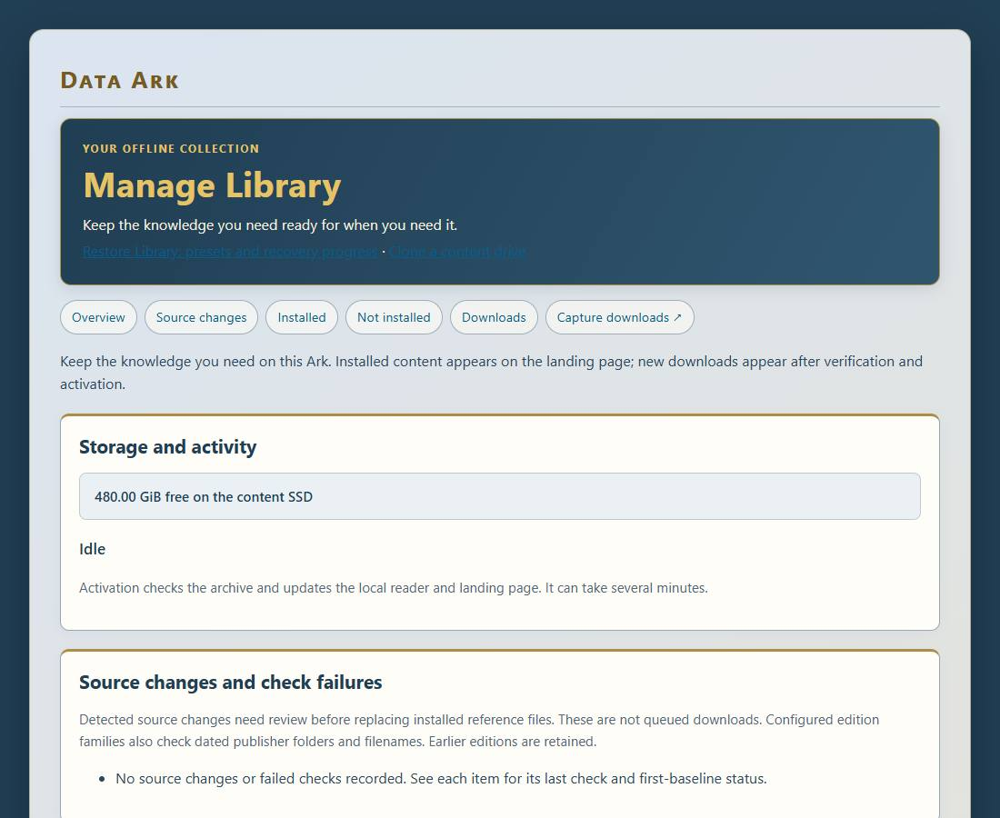
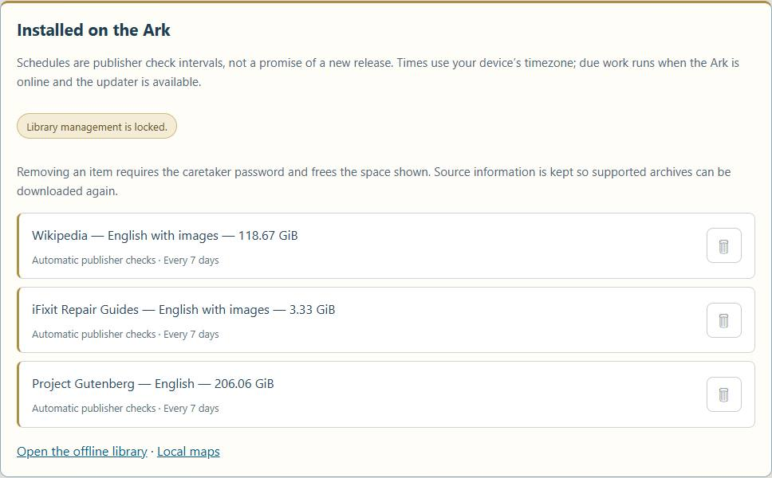
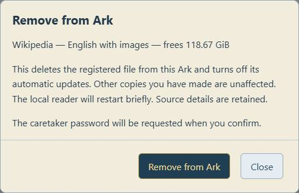
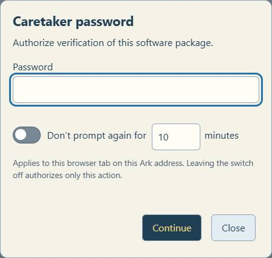

# Library management and distribution

## Entry point and permissions

Open the dashboard's Settings gear, choose System, select the Library tab, then Manage Library. Installed content remains on the landing page; available sources belong in management rather than appearing as offline holdings.



Public reading and copying require no caretaker login. Install, remove, and reinstate operations currently require the same administration password as network settings. Public requests and storage-based approval policies are future work. The helper accepts registered identifiers, not arbitrary caller-supplied shell commands or download locations.

## Download lifecycle

Check available downloads to fetch official publisher metadata. Review the language, coverage, release, size, and free SSD space before confirming. Currently the curated additional-download list offers English Project Gutenberg. Supported existing archives use their registered Kiwix update series.

- Requesting checks authentication, publisher metadata, disk space, and the worker lock.
- Queued means the manifest registration was accepted and the systemd updater was requested.
- Downloading transfers the archive into hidden staging, with automatic resume where supported.
- Verifying checks expected size, ZIM structure, and the publisher SHA-256 hash.
- Activating verifies the staged replacement again, updates Kiwix, and checks its catalogue.
- Publishing updates the portable catalogue, landing page, and documentation.
- Complete means the installed archive is ready. A queued response does not establish completion.

The updater runs through dataark-update.service and dataark-update.timer. Progress is stored in /var/lib/dataark/updates/status.json and appears in Manage Library and the dashboard. A large archive can take considerable time to download and verify. No fixed completion time is promised.

## Remove an installed file

Use its right-aligned trash can. Review the exact collection and displayed space, supply the caretaker password if the page is locked, then explicitly confirm Remove from Ark. The action updates the reader and published catalogue before deleting its staged file. It disables automatic updates for that asset and retains its source metadata.





Removal applies to the registered file. For a portable program registration this is not a recursive deletion of the entire distribution folder; other files may remain. Removal does not delete copies already made on other devices or unrelated historical archives that were never registered as that asset.

The worker lock prevents removal racing an update. A durable removal journal supports rollback before commit and final cleanup after commit. Do not manually delete its hidden staging file or journal. If interrupted, the updater attempts recovery before processing new work.

## Reinstate a removed collection

The Not installed list retains removed records. Supported ZIM archives, including pre-seeded archives, offer Reinstate. The helper checks an available publisher release and free space, re-enables that asset and its repository, clears its update-check history, and requests the updater. The downloaded file must still pass verification and activation.

Reinstatement needs upstream internet and is not a recovery guarantee if the publisher no longer offers the series. Utilities without an automatic adapter keep the original package link for manual restoration. Do not run an incompatible program merely because its file is present.

## Session behavior



Caretaker actions use an on-demand password prompt. Remembering is optional: choose 1–120 minutes (default 10). The fixed expiry does not extend with use. The cache survives navigation and reload in the same browser tab and Ark address using tab-scoped session storage; it is not shared across addresses or independent tabs. Expiry, a rejected credential, **Lock now**, or the floating red unlocked padlock clears it. The padlock shows remaining minutes; the inline indicator gives the same countdown. Without remembering, only that action is authorized. A rejected password explicitly says **Password not accepted**. The server verifies every protected request. Each removal still needs confirmation.

## Diagnostics

The existing /api/events stream includes library authentication outcomes, collection/action, correlated stages, duration, bytes freed or requested, errors, and rollback/recovery results. Detailed stages and coarse progress require Debug; basic operation outcomes remain logged with Debug off. Passwords, authorization headers, and request bodies are excluded. Logging failures should not interrupt content recovery.

The separate portal monitor records bounded local network diagnostics while Debug is enabled. Its capture is not the library-operation log. Consult both only when a failure crosses the network/application boundary.

## Install or update management support

After reviewing the helper, run this in a terminal on the Ark:

```sh
cd /opt/dataark
sudo venv/bin/python deploy/install_library.py
```

 This installs a root-owned fixed-scope helper and a narrowly scoped sudo rule. Deploy the web/API changes and restart dataark.service. Installation does not download a collection itself.

After a code change, verify anonymous inventory access, rejection of unauthenticated mutation requests, a disposable-fixture removal/rollback test, and a visible confirmation. Do not remove a user's archive merely to test the interface.

## Distribution methods

- Browser: Apache serves the landing page and /library-files/; Kiwix serves ZIM reading on port 8080.
- SMB: Offline-Archives exposes the content SSD read-only. Guest access depends on client policy; Samba accounts are separate from caretaker authentication.
- FTP: vsftpd provides anonymous read-only public-library files under /library, with a read-only service mount and inaccessible private/staging directories. Port 21 is control; passive data ports are 30000–30009. Upload, rename, deletion, and local-account FTP logins are disabled.
- SFTP: the existing SSH service supports authorized Pi accounts on port 22. Use /mnt/storage for content. This is not anonymous or automatically read-only.
- rsync: rsync over SSH is available to authorized Pi accounts for resumable/scripted copying. There is no anonymous rsync daemon configured.
- Direct SSD: shut down cleanly, connect OfflineRepo to another computer, and open START-HERE.html. A compatible reader remains necessary.

FTP installation: install the Debian vsftpd package, then run sudo python3 deploy/install_ftp.py. The tracked configuration is in deploy/ftp. Test anonymous listing, a small download, resume, blocked writes, and denial of all staging/private paths. Do not expose administration endpoints or SSH accounts merely to provide public library access.

## Displayed update schedule

Manage Library displays each registered item’s effective update policy and configured publisher-check interval, its last completed worker check from checked.json, and its next due time. These are read-only settings. Times are formatted in the viewing device’s timezone. Due work waits for connectivity and the worker; it is not a guaranteed start time or publisher release date. Manual, disabled and removed items are not scheduled. Missing history is shown as not recorded; unreadable or invalid history is shown as unavailable rather than inventing a date.
